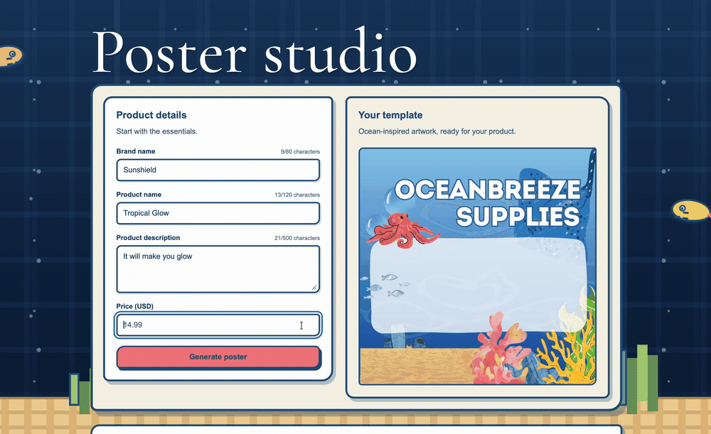

# Oceanbreeze Poster Studio

A small full-stack application that turns a brand name, product name, description, and price into a downloadable marketing poster. Generated posters are saved locally and can be reopened from history after a page refresh or server restart.

## Demo



## Run locally

Requires **Node.js 22.13 or newer** and npm. Development and testing used Node.js 24.9.0. No API keys or separate database installation are needed.

From the project root:

```sh
npm ci
npm run dev
```

Open **http://127.0.0.1:5173/**. This starts the React frontend and Express API together. The API listens on port `3001`; Vite forwards `/api` requests to it.

Enter product details, click **Generate poster**, and download the result with **Download PNG**. Select a previous generation to view it again.

### Run the built application

Stop the development servers first, then run:

```sh
npm run build
npm start
```

Open **http://127.0.0.1:3001/**. Express serves both the built frontend and API. Keep the full project directory: the renderer also reads the background and fonts from the source asset directories.

### Checks

```sh
npm run typecheck
npm test
npm run build
```

Tests cover input validation, currency parsing, long-text rendering, PNG retrieval, history pagination, persistence after reopening SQLite, and rendering failures. Tests use temporary databases, leaving application history untouched. The failure-path test intentionally logs a simulated rendering error; check the final test summary for the result.

## How it works

1. The React form submits the four fields to Express and shows a loading state.
2. The API validates the input and renders navy text over the selected background using `@napi-rs/canvas`.
3. The resulting **1587 × 1587 PNG** and product details are saved together in SQLite.
4. The response updates the preview and history without a manual refresh.

### Key decisions

- **React + TypeScript, Express + TypeScript:** one language across the frontend and backend, with npm workspaces and a shared lockfile.
- **Template-based rendering:** predictable output without an external image-generation service, credentials, or per-generation cost. Text wraps and scales down to fit the panel; long unbroken words wrap too.
- **SQLite via Node's built-in `node:sqlite`:** no database service to configure. Storing image bytes and metadata in the same record avoids mismatched files and history entries. Some supported Node versions emit an experimental SQLite warning.
- **Integer cents:** prices are validated as decimal strings and stored as integer cents to avoid floating-point currency rounding.
- **Request-based generation:** the browser waits for the rendered result. There is no background job queue; the API allows up to four concurrent renders and returns a retryable message when busy.
- **Fixed retailer branding:** “Oceanbreeze Supplies” is treated as the fictional retailer in the example artwork. The submitted brand remains a separate field. This is a design assumption, not an extra input requirement.

## Input and storage

| Field | Limit |
| --- | --- |
| Brand name | 80 characters |
| Product name | 120 characters |
| Description | 500 characters |
| Price | USD $0.01–$999,999.99, up to two decimal places |

Text fields are required; surrounding whitespace is trimmed and repeated whitespace is normalized. The form shows character counters, and the API independently validates requests.

History is stored in `server/data/posters.sqlite`, created automatically and excluded from Git. History loads 12 entries at a time, with a **Load more** button.

Optional environment variables:

- `DATA_DIR`: storage directory; use an absolute path for predictable placement.
- `PORT`: API port, default `3001`. If changed during development, also update the proxy in `client/vite.config.ts`.

Set variables in the shell; the application does not automatically load `.env` files.

## Project structure

```text
client/src/              Form, preview, history, and styles
client/public/assets/   Selected backgroundtemplate.png
client/public/fonts/    Website title font and accompanying notice
server/src/app.ts       API routes and error handling
server/src/validation.ts Input validation and currency parsing
server/src/poster.ts    Text layout and PNG rendering
server/src/store.ts     SQLite persistence
server/src/index.ts     Startup and shutdown
server/assets/fonts/    Poster fonts and license
server/test/            Automated workflow tests
```

## Known limitations

- One fixed template and USD pricing; no template editor, product-photo upload, or currency selection.
- Long inputs produce smaller text. The bundled poster font does not cover every language or emoji.
- A local, single-user application: no authentication, per-user history, deletion, or storage quota. Images are stored at full resolution, so the database grows with use.
- Generation is not resumable. If a connection drops after saving, check history before retrying to avoid duplicate posters.
- The website title uses Cormorant Garamond under the SIL Open Font License, included in `client/public/fonts/cormorant-garamond/OFL.txt`. Posters use Liberation Sans, with its license included in `server/assets/fonts/`.

## With more time

Add more templates, broader font/language coverage, history deletion and thumbnails, and automated browser tests for desktop/mobile workflows. For a hosted multi-user version, add authentication, storage limits, and a durable generation queue.

## AI tools used

OpenAI Codex assisted with scaffolding, API and database implementation, tests, debugging, and documentation. The ocean background was supplied from Canva. The website's visual style was adapted from an existing personal project.

The application itself does not call an AI service. Poster generation is deterministic template rendering.
